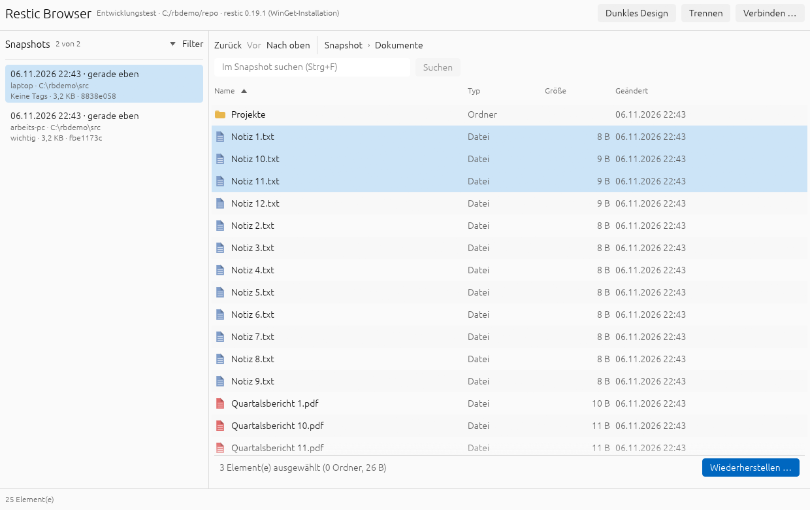
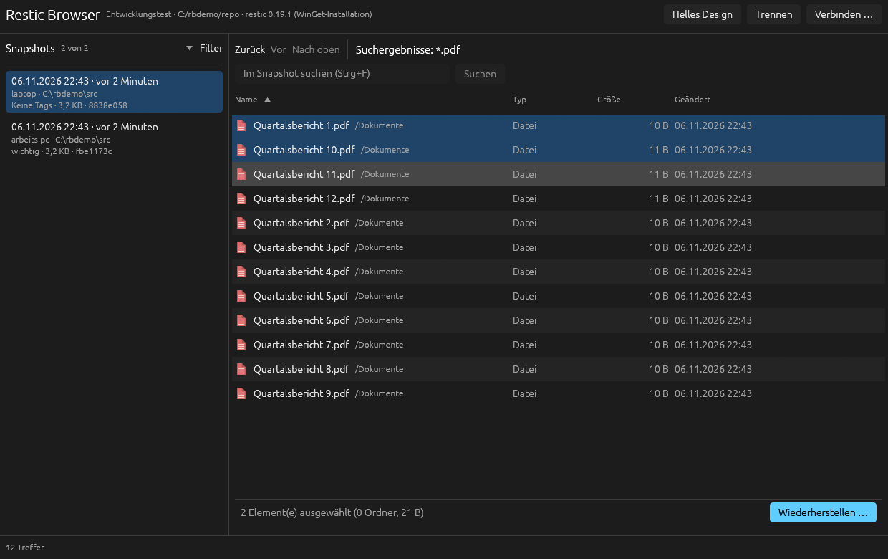
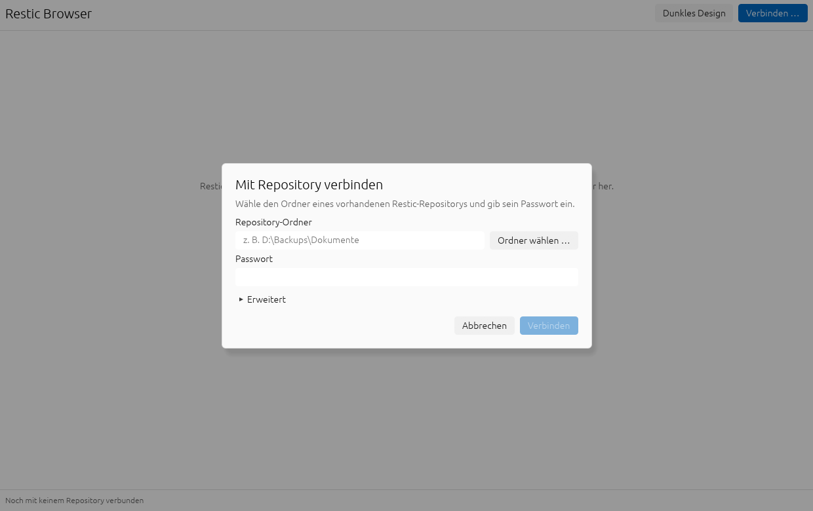
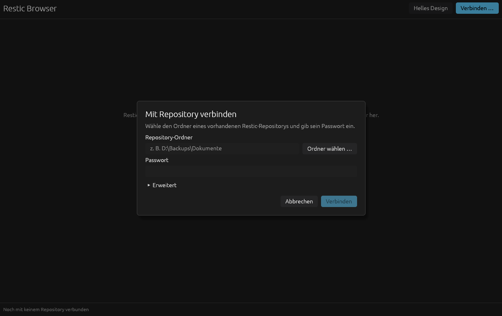
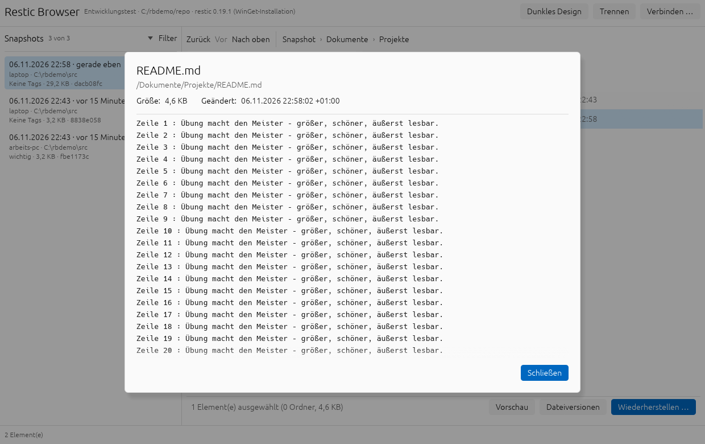
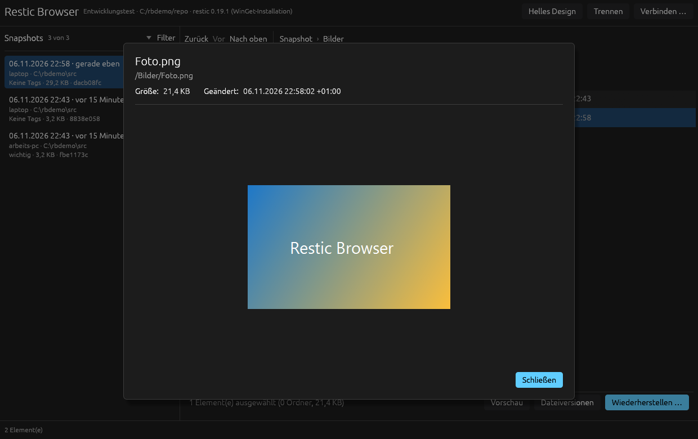
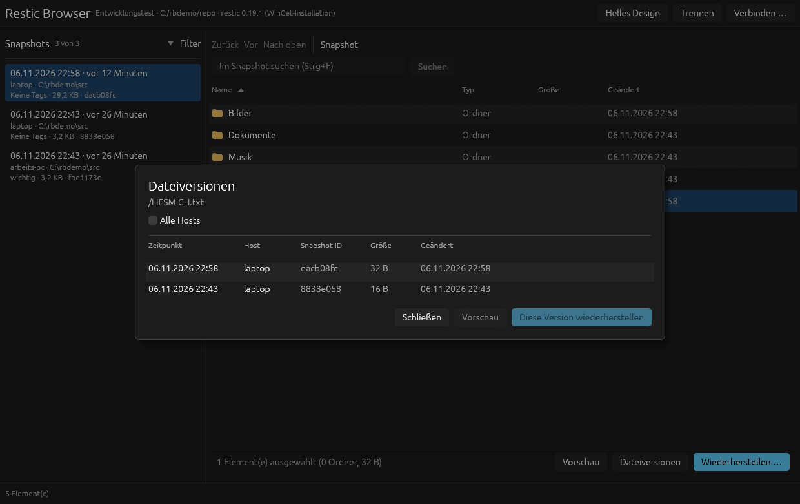

# Rust-Migration

Stand: Phase 0 (Vorbereitung). Die C#/Avalonia-Anwendung (Linie 3.x) bleibt bis zum
Paritätsnachweis die einzige veröffentlichte Version. Die Rust-Version erscheint als 4.0.0.

## Entscheidungen

1. **Struktur:** Der Rust-Workspace liegt im Unterordner `rust/` dieses Repositorys.
   Verhaltens-Fixtures, Doku, Versionsquelle und Release-Ablauf werden geteilt.
2. **UI-Framework:** Slint (nativ, eine Binärdatei, kein WebView). **Vor Phase 5 offen:**
   Lizenzprüfung (GPLv3, Royalty-free oder kommerziell) und ein UI-Spike für Tabellen,
   Themes und dunkle Titelleiste. Fallback: egui.
3. **Regeln:** Fachliche Regeln aus `AGENTS.md` (nur lesend, deutsche Texte, Secrets nur im
   Speicher, keine Laufzeit-Downloads, keine dauerhaften Caches, Restic als einzige
   Schnittstelle) gelten unverändert. Die technischen Prüfbefehle für Rust stehen in
   `AGENTS.md`; die .NET-Befehle gelten weiter für die C#-Linie.

## Zielarchitektur (`rust/`)

| Crate | Inhalt | Vorlage in C# |
|---|---|---|
| `restic-core` | Runner, Command-Builder, Locator, Provisioning, JSON-Modelle, Repository-Service, Batching, Fehlertexte | `Services/*`, `Models/Models.cs` |
| `restic-app` | Einstellungen, Profile, Filter, Navigation, Verzeichnis-Cache | `SettingsService.cs`, `ViewModels/*` |
| `restic-ui` | Slint-Oberfläche, Dialoge, Themes | `Views/*`, `MainWindow.axaml`, `App.axaml` |
| `restic-testkit` | Fake-Runner, Prozess-Fixture-Binary | `tests/.../Fakes.cs`, `--runner-fixture` |

Geplante Bibliotheken: `tokio`, `serde`/`serde_json`, `sha2`, `directories`, `fd-lock`,
`tempfile`, `secrecy`/`zeroize`.

## Verbindliche Grenzwerte (müssen identisch bleiben)

- `FindNewest` beendet restic nach dem ersten gültigen Treffer, `Find` nach 10.000 Treffern.
- Batches höchstens 256 Einträge, der erste Batch sofort, Backpressure zum Produzenten.
- Verzeichnis-Cache: 24 Einträge und höchstens 50.000 Knoten, LRU, nie dauerhaft.
- Genau ein Collection-Reset pro Batch-Befüllung, genau ein restic-Aufruf für „Neueste Datei“.
- Kein automatisches `stats` beim Verbinden.
- `--no-lock` bei allen lesenden Befehlen.
- Check-Details auf 64 KiB UTF-8 begrenzt; Speicheranalyse bis 100.000 Ordnerpfade.
- Versionsprüfung von restic mit 5 s Timeout, Version 0.19.1 aus `build/restic-manifest.json`.
- Einstellungen: Prozess-Sperrdatei höchstens 5 s, atomares Schreiben, defekte Datei nie
  überschreiben, `settings.json.bak` vor Entfernung alter Profiltypen.

## Verhaltensparität: Zuordnung der 66 C#-Tests

Quelle: `tests/ResticBrowser.Tests/Program.cs`. Jeder Test braucht in Rust ein Gegenstück
in der genannten Phase. Der Abschnitt „Fixtures“ nennt die dafür vorgesehenen Dateien.

| Phase | Zu portierende Tests |
|---|---|
| 1 Runner und Befehle | Runner beendet Prozesse bei Fehlern, Abbruch und frühem Ende; JSON-EOF wartet auf Exitcode und bleibt abbrechbar; Integritätsprüfung streamt und begrenzt Details; JSON-Array beendet Restic nach frühem Ende; JSONL-Verzeichnis zeilenweise; Binärvorschau erhält Originalbytes; Binäre Prozessausgabe begrenzt; Snapshot JSON toleriert Zusatzfelder; JSONL ignoriert unbekannte Zeilen; Restore-Argumente getrennt und vollständig; Repository-Befehle lesend ohne Lock; Überschreibmodi; Restore-Vorschau-Argumente; Backend-Variablen sicher geprüft; Zugangsdaten beim Dispose geleert; Stats und Dump Befehle; Zugriffsfehler plattformneutral; Symlink-Fehler ergeben Teilerfolg; zusätzliche Restore-Fehler bleiben Fehler; Restore-Fehlerausgabe begrenzt; Fehlerhinweise für bekannte Restic-Fehler; Snapshot-Pfade normalisiert; Mount-Optionen für beide Ansichten; Linux-Aushängen |
| 2 Auflösung | Restic-Suche unterscheidet Windows und Linux; Auswahl gewinnt und manipulierte Datei wird abgewiesen; Kandidaten eindeutig und Linux-Systempfade; Automatik überspringt beschädigte Kandidaten; Prüfung behandelt JSON, Version, Fehler, Timeout, Abbruch; Linux prüft Rechte und Symlinks; Herkunft bleibt Laufzeitinformation |
| 3 Repository-Service | Streaming: Treffer vor Ende einer Snapshot-Gruppe; UTF-8 und Zusatzfelder an Chunk-Grenzen; Snapshots vor Abschluss und final sortiert; Snapshot-Fehler und getrennte Verbindung; Suchlimit und begrenzte Batches; Suche begrenzt sichtbare Treffer; Dateiversionssuche stoppt am Limit; Dateiversionen nutzen bekannte Snapshots; Neueste Datei mit genau einem Prozess; Restore-Ziel schützt das Repository; Speicheranalyse (Fortschritt, Ordnerlimit); E2E mit echtem restic |
| 4 Anwendungslogik | Entfernte Profile gesichert; Profildateifehler erhalten Original; Paralleles Speichern; Altprofile entfernt; Entfernte Backends abgelehnt; Linux-Einstellungen mit `XDG_DATA_HOME`; Einstellungen speichern Bedienzustand abwärtskompatibel; Snapshot-Filter (unsortierte Eingabe, Streaming-Aktualisierung); Batch-Collection (Auswahl ohne Reset, genau ein Reset); Verzeichnis-Cache (Einträge, Knoten); Verbindungszustand vor Snapshot-Auswahl; Veraltete Navigation überschreibt nichts; Späte Statistiken getrennter Verbindung ignoriert; Relative Zeit; Pfadleiste; Performance bei großen Datenmengen |
| 6 Pakete und CI | Zentrale Produktversion und Build-Konsistenz; Release-Vorabprüfung (fehlende, passende, abweichende Assets) |
| 5 UI | Ersatz für `UiLayoutChecks.cs`: Screenshots Hauptfenster und Verbindungsdialog in Hell und Dunkel |

Hilfsmodi des C#-Runners, die als `restic-testkit`-Binary nachzubauen sind:
`--runner-fixture <failed|array|find|invalid|settings-lock|…> <pidfile>` (schreibt PID, gibt
definierte Ausgabe auf stdout, flutet stderr, beendet sich nicht von selbst) und der
Askpass-Modus über `RESTIC_BROWSER_ASKPASS_PIPE`.

## Fixtures

`rust/fixtures/generate.sh` erzeugt aus einem Wegwerf-Repository mit zwei Snapshots
(Host `fixture-host`, Tag `fixture`, Umlaute in Pfaden) bereinigte Ausgaben von restic 0.19.1
unter `rust/fixtures/restic-<Version>/`:

- `version.json`, `snapshots.json`, `backup-1.jsonl`, `backup-2.jsonl`
- `ls-snapshot.jsonl`, `ls-recursive.jsonl`, `find-a.json`, `find-empty.json`
- `stats.json`, `check.txt`
- `error-wrongpassword.txt`, `error-norepo.txt`

Bereinigung: Temp-Pfade werden zu `/fixture`, Benutzername zu `fixture-user`, übergeordnete
Verzeichniseinträge entfallen. Das Skript läuft unter Windows (Git Bash) und Linux. Das
Wegwerf-Passwort dient nur dem temporären Repository und wird nicht gespeichert. Vor jedem
Commit der Fixtures auf Namen, Pfade und Rechnernamen prüfen.

Hinweise zur restic-Ausgabe unter Windows: `restore` auf einen Pfad mit Laufwerksbuchstaben
meldet Zeitstempelfehler für übergeordnete Ordner; Restore-Fixtures daher nur mit `--include`
auf einen Unterordner erzeugen; seit Phase 3 enthalten (`restore.jsonl`, `restore-preview.jsonl`).

## Phasen und Status

| Phase | Inhalt | Status |
|---|---|---|
| 0 | Entscheidungen, Fixtures, Testzuordnung, Regeln | abgeschlossen |
| 1 | Runner, Command-Builder, serde-Modelle | Kern fertig (53 Tests); offen: Prozessbaum beenden, Rest siehe unten |
| 2 | Restic-Auflösung, Provisionierung | Kern fertig (75 Tests); eingebettete Windows-Datei folgt in Phase 6 |
| 3 | Repository-Service, Mount, Askpass | Service fertig (131 Tests); Mount und Askpass offen |
| 4 | Einstellungen, Filter, Cache | fertig (190 Tests im Workspace) |
| 5 | UI (egui), Themes, Dialoge | Teil 1 fertig: Hauptfenster, Verbinden, Wiederherstellen (siehe unten); weitere Fenster offen |
| 6 | Pakete, Installer, CI/CD | offen |
| 7 | Paritätsprüfung, 4.0.0, Entfernung des C#-Codes | offen |

## Risiken

| Risiko | Gegenmaßnahme |
|---|---|
| Tabellen- und Theme-Qualität des UI-Frameworks reicht nicht | UI-Spike vor Phase 5, Fallback egui |
| Slint-Lizenz passt nicht | vorab prüfen, sonst egui oder iced |
| Abweichungen beim Streaming und frühen Abbruch | Fixture-Tests und identische Grenzwerte |
| Sicherheitsregressionen bei Secrets und Pfadprüfung | `secrecy`/`zeroize`, übernommene Pfadtests, Review |
| Doppelte Pflege während der Migration | 3.x nur noch Fehlerbehebungen |

## Stand Phase 1 (Runner, Befehle, Modelle)

Umgesetzt in `rust/crates/restic-core` (Gegenstücke in Klammern):

- `runner.rs` – asynchroner Runner mit `run`, `run_lines`, `run_binary`, `run_json`,
  `run_json_array(_until)` und `run_find_matches_until` (`ResticProcessRunner.cs`).
  Start ohne Shell, stdin geschlossen, stderr auf 64 KiB begrenzt aber vollständig geleert,
  früher Abbruch beendet den Prozess, Benutzerabbruch bleibt `ResticError::Cancelled`.
- `json_stream.rs` – byteweiser Scanner für JSON-Arrays und `find`-Treffer innerhalb einer
  Snapshot-Gruppe (`FindMatchReader.cs`), tolerantes JSONL-Lesen.
- `command.rs`, `env_validator.rs`, `guidance.rs`, `bounded_details.rs`, `credentials.rs`,
  `models.rs` (`ResticCommandBuilder`, `BackendEnvironmentValidator`, `ErrorGuidance`,
  `BoundedCheckDetails`, `SessionCredentials`, `Models.cs`).
- `rust/crates/restic-testkit` – Fixture-Binary `runner-fixture` und 17 Prozess-Tests.
  Prozessende wird über einen Heartbeat geprüft (`tasklist` braucht auf manchen Windows-Systemen
  über 30 s je Aufruf).

Bewusste Abweichungen und offene Punkte:

- Callbacks sind `async`-Closures mit `Flow::{Continue, Stop}` statt `Task<bool>`.
- Größenangaben verwenden das deutsche Dezimalkomma (`1,5 KB`) unabhängig von der Systemsprache;
  in C# hing das von der Thread-Kultur ab.
- Zeilenumbrüche in gesammelter Ausgabe und Prüfdetails sind immer `\n`.
- **Offen:** C# beendet mit `Kill(entireProcessTree: true)` den ganzen Prozessbaum. Rust beendet
  bisher nur den Hauptprozess. Für `restic mount` und Hilfsprozesse in Phase 3 über Job Objects
  (Windows) bzw. Prozessgruppen (Linux) lösen; dafür ist `unsafe` oder eine Bibliothek nötig und
  daher eine eigene Entscheidung (`unsafe_code = "forbid"` gilt derzeit im Workspace).
- **Offen:** `RepositoryProfile`, `SettingsService` und `AppSettings` gehören zu Phase 4.
- Prüfwerkzeuge: `cargo fmt --check`, `cargo clippy --all-targets -- -D warnings`,
  `cargo test --release`, `cargo audit` laufen sauber (Rust 1.99.1, MSVC-Build-Tools).

## Stand Phase 2 (Auflösung und Provisionierung)

Umgesetzt in `rust/crates/restic-core`:

- `locator.rs` – Kandidaten in fester Reihenfolge (neben der Anwendung, `tools`, `PATH`, Linux-Systempfade
  bzw. WinGet), Duplikate je nach Plattform mit oder ohne Groß-/Kleinschreibung, Dateiprüfung mit
  deutschen Fehlern (fehlt, leer, nicht lesbar, nicht ausführbar), Herkunftstext (`ResticLocator.cs`).
- `version_probe.rs` – `restic version --json` mit 5 s Zeitlimit, Mindestversion 0.17.1, ohne Rohausgabe
  in Fehlermeldungen; Zeitlimit und Benutzerabbruch bleiben unterscheidbar (`ResticVersionProbe.cs`).
  Das Trait `VersionProbe` macht die Prüfung austauschbar.
- `provisioning.rs` – `ResticResolver` (ausdrücklich gewählte Datei ohne Ersatz, mitgelieferte Datei nur mit
  passender SHA-256, abgelehnte Datei nie als ungeprüfte portable Datei) und `provision_embedded`
  (prozessübergreifende Sperrdatei, temporäre Datei, Prüfung, atomares Verschieben, keine ausführbare
  Zieldatei bei Fehlern) (`ResticProvisioningService.cs`).
- `manifest.rs` – bettet `build/restic-manifest.json` zur Compile-Zeit ein. Version und Prüfsummen
  haben damit genau eine Quelle (in C# stand die Windows-Prüfsumme zusätzlich als Konstante im Code).
- `restic-testkit`: `fake-restic` (Verhalten über Sidecar-Datei `<pfad>.mode`, Start-Protokoll
  `<pfad>.log`) und 13 Tests mit echten Prozessen; Mutationstests für Prozessende und Hash-Prüfung
  wurden einmalig durchgeführt und schlugen wie erwartet an.

Bewusste Abweichungen und offene Punkte:

- `ResticResolver::without_system_locations()` schließt Linux-Systempfade und WinGet aus. Tests sind
  damit hermetisch; auf Entwicklungsrechnern mit installiertem restic fanden sie sonst das System-restic.
- **Nicht lokal prüfbar (nur unter Linux/CachyOS):** `linux_checks_permissions_symlinks_and_bundle_hash`
  (Ausführungsrechte, relative Symlinks, mitgelieferte Datei mit Prüfsumme) ist mit `#[cfg(unix)]`
  geschrieben, wurde aber nur kompiliert, nicht ausgeführt. Vor dem Abschluss von Phase 2 unter CachyOS
  oder in der CI ausführen.
- Die eingebettete Windows-Datei wird erst in Phase 6 per `build.rs`/`include_bytes!` angebunden;
  bis dahin übergibt der Aufrufer sie über `with_embedded_windows`. Der Windows-Pfad ist mit der
  Test-Binärdatei als Nutzlast geprüft.
- Relative `PATH`-Einträge werden nicht gegen das aktuelle Verzeichnis aufgelöst (C# nutzt
  `GetFullPath`); `PATH` ist normalerweise absolut.
- Lehre: Die Wurzel-`.gitignore` ignoriert `bin/`. `rust/.gitignore` hebt das für `src/bin/` auf.
  Der Phase-1-Commit enthielt deshalb `runner-fixture.rs` nicht; sie ist mit Phase 2 nachgetragen.

## Stand Phase 3 (Repository-Service, ohne Mount)

Umgesetzt in `rust/crates/restic-core` (Gegenstück: `ResticRepositoryService.cs`):

- `repository.rs` – `ResticRepositoryService` mit `validate`, `get_snapshots(_batched)`,
  `get_directory_batched`, `find(_batched)`, `find_newest`, `get_file_versions`, `restore`,
  `preview_restore`, `check`, `get_stats`, `get_file_preview` und `analyze_snapshot_storage`.
  Fehlerabbildung (`create_exit_error`) mit den deutschen Meldungen der C#-Linie.
- `result_batch.rs` – erster Treffer sofort, danach höchstens 256 je Batch oder alle 100 ms,
  `async`-Zustellung mit natürlicher Gegendruck-Wirkung.
- `paths.rs` – Überlappungsschutz für Restore- und Mount-Ziele mit Auflösung von Verknüpfungen,
  Ablehnung von `..`, plattformabhängigem Vergleich (`validate_destination`, `validate_mount_location`).
- `storage.rs` – `StorageAnalyzer` (Kategorien, je 15 größte Ordner/Dateien, höchstens 100.000
  Ordnerpfade, deterministische Reihenfolge bei Gleichstand).
- `profile.rs` – Profil mit Prüfung auf lokale Repositories (Persistenz folgt in Phase 4).
- `restic-testkit`: `scripted-restic` (Skript je Befehl, Generatoren für große Ausgaben, Protokoll
  von Starts/Argumenten/Passwort, `hang_after` für Early-Stop-Tests) und 28 Service-Tests, darunter
  ein End-to-End-Test mit echtem Restic (`RESTIC_BROWSER_TEST_RESTIC` oder Auflösung; mit
  `RESTIC_BROWSER_REQUIRE_RESTIC=1` wird ein fehlendes Restic zum Fehler statt zum Überspringen).
- Fixtures: `restore.jsonl` und `restore-preview.jsonl` ergänzt; das Skript sichert jetzt mit
  relativer Wurzel (`backup .`).
- Mutationstests (einmalig): Überlappungsschutz abgeschaltet und Suchlimit +1 werden von den
  Tests erkannt.

Messwerte (Windows, Release nicht nötig): Analyse von 100.000 Knoten über echte Pipe rund 0,5 s;
Suche, Dateiversionen und Verzeichnislisten beenden Restic nachweislich (Heartbeat endet).

**Befund für die manuelle Prüfung (gilt auch für C# 3.x):** Wird unter Windows eine Datei aus einem
Snapshot mit **absoluten** Pfaden wiederhergestellt (z. B. `C:\Users\…`), meldet Restic beim Setzen
der Zeitstempel des Vorfahren-Ordners `C:\Users` „Zugriff verweigert“ und beendet sich mit Exitcode 1,
obwohl die Datei wiederhergestellt wurde. `restore` meldet dann einen Fehler. Mit relativen Pfaden
(`backup .` im Quellordner) tritt das nicht auf. Ob solche reinen Vorfahren-Zeitstempelfehler künftig
als Hinweis statt als Fehler behandelt werden sollen, ist eine eigene Entscheidung; bis dahin
verhalten sich C# und Rust gleich.

Bewusste Abweichungen und offene Punkte:

- Benutzerabbruch einer Vorschau bleibt `Cancelled` (in C# wurde er in einen Fehlertext verwandelt).
- Ungültige Ausgabe von `stats` ergibt einen deutschen Fehler statt einer unbehandelten Ausnahme.
- Sortierung der Verzeichnisliste vergleicht Kleinbuchstaben (`to_lowercase`) statt der
  Windows-Kultur; bei deutschen Umlauten kann die Reihenfolge in Randfällen von C# abweichen.
- **Nicht ausgeführt (nur unter Linux):** Symlink-Alias auf das Repository (`paths.rs`) und der
  Read-only-Repository-Teil sowie die Glob-Namen (`a*.txt`, `b?.txt`, `c[1].txt`) im End-to-End-Test.
  Zusammen mit dem Linux-Test aus Phase 2 unter CachyOS oder in der CI auszuführen.
- **Offen in Phase 3:** `StartMountAsync`, `LinuxMountUtilities` und die Askpass-Pipe. Mount braucht
  das Beenden des Prozessbaums (siehe Stand Phase 1) und ist eine eigene Entscheidung.

## Stand Phase 4 (Anwendungslogik, Crate `restic-app`)

Neues Crate `rust/crates/restic-app` (Gegenstücke: `SettingsService.cs`, `SnapshotFilter.cs`,
`NavigationHistory.cs`, `MainViewModel.*`, `BatchObservableCollection.cs`):

- `settings.rs` - `settings.json` im Format der 3.x-Linie (PascalCase, Typ als Zahl, Guid als Text),
  prozessübergreifende Sperrdatei mit 5 s Zeitlimit, atomares Schreiben (temporäre Datei, `fsync`,
  Ersetzen), beschädigte Dateien werden nie überschrieben, nicht mehr unterstützte Profile werden
  einmalig nach `settings.json.bak` gesichert. Es werden weder Geheimnisse noch Laufzeitwerte gespeichert.
- `filter.rs` - Text-, Host- und Tag-Filter, „nur neueste je Host und Pfad“ auch inkrementell.
  10.000 Snapshots filtern in rund 11 ms.
- `cache.rs` - LRU-Verzeichnis-Cache mit höchstens 24 Einträgen und 50.000 Knoten, nur für die Sitzung.
- `navigation.rs`, `list.rs` - Verlauf; `BatchList` meldet Anhängen (`Appended`) und Ersetzen (`Reset`)
  als genau eine Änderung.
- `backend.rs` - Trait `RepositoryBackend` (für `ResticRepositoryService` implementiert) und
  `BatchSink`: Treffer fließen über einen Kanal mit Kapazität 1. Das ersetzt die `async`-Rückrufe der
  C#-Linie und liefert Gegendruck sowie Abbruch, wenn die Sitzung die Operation ersetzt.
- `session.rs` - `BrowserSession` als Zustandsmaschine des Hauptfensters: Verbindung, Snapshots mit
  Streaming, Verzeichnisse mit Cache, Suche, Neueste Datei, Statistik, Restore, Filter mit 200 ms
  Verzögerung, Trennen. Jede Operation hat Version und Abbruchsignal; verspätete Ergebnisse ersetzter
  oder getrennter Operationen werden verworfen. Änderungen gehen als `Change` an Beobachter
  (`subscribe`), der Zustand wird über `view` gelesen. Die Oberfläche in Phase 5 bindet daran.
- Tests (57 in `restic-app`): Dateitests der Einstellungen inklusive gehaltener Sperre (5 s) und
  40 parallele Speicherungen; 25 Sitzungstests mit gesteuertem Fake-Backend (Race-Bedingungen, späte
  Batches, Abbruch, Trennen, Cache, Navigation, Filter-Verzögerung). Die Sitzungstests liefen in 20
  Wiederholungen ohne Fehlschlag. Mutationstests (Versionsprüfung des Batch-Verbrauchers und der
  Verzeichnisübernahme entfernt) werden erkannt.

Bewusste Abweichungen und offene Punkte:

- Reihenfolge der Anzeige: Nach dem Laden der Snapshots lädt die Sitzung sofort das Wurzelverzeichnis;
  dessen Status überschreibt „N Snapshot(s) geladen“ (wie in C#).
- Einstellungen: Beim Lesen werden PascalCase und camelCase akzeptiert, nicht beliebige Schreibweisen
  (C# liest ohne Beachtung der Groß-/Kleinschreibung). Fenstergrößen werden als `1200.0` statt `1200`
  geschrieben; beide Formen sind für beide Programme lesbar.
- Fehler der Einstellungen werden in der Sitzung als `ResticError` mit der deutschen Meldung geführt
  (C#: eigene `SettingsException`).
- `VisibleSnapshots` meldet bei Entfernen einzelner Zeilen `Reset` statt einer Einzelentfernung.
- Stabile Reihenfolge: Hosts/Tags werden ohne Beachtung der Schreibweise sortiert (C#: Kultur).
- Entfernen von `BatchObservableCollection`-Auswahlerhalt ist Sache der Oberfläche (Phase 5): Die
  Änderungen liefern dafür `Appended { start, count }`.
- Noch nicht Teil der Sitzung: Speicheranalyse, Prüfung und Mount (die Fenster rufen den Service
  direkt auf, wie in C#).

## Stand Phase 5, Teil 1 (Oberfläche mit egui, Crate `restic-ui`)

Binär `restic-browser` (`rust/crates/restic-ui`, Gegenstück zu `MainWindow`, `ConnectionWindow`,
`RestoreWindow`). Die Oberfläche hängt an `BrowserSession` und liest den Zustand pro Bild; Aktionen
werden nach dem Zeichnen angewendet (nie ein Sitzungsaufruf innerhalb der Lesesperre).

Umgesetzt:

- **Hauptfenster:** Kopf (Verbinden, Trennen, Design), einklappbare Snapshot-Filter, virtualisierte
  Snapshot-Liste, Pfadleiste mit Zurück/Vor/Nach oben, Suche im Snapshot, Dateitabelle mit Mehrfachauswahl
  (Strg, Umschalt, Pfeiltasten, Strg+A, Esc), Sortierung, Doppelklick öffnet Ordner, Aktionsleiste
  direkt am Browser, Statusleiste mit Abbrechen, Leerzustand mit gespeicherten Profilen.
- **Dialoge (modal, gemeinsamer Rahmen):** Verbinden (Ordnerwahl, Passwort verdeckt und nach Gebrauch
  überschrieben, optionale Restic-Datei, deutsche Fehlerhinweise) und Wiederherstellen (Ziel, Überschreibmodus,
  Vorschau, Fortschritt, Abbrechen).
- **Gemeinsame Bausteine:** `theme.rs` (alle Farben zentral, Hell/Dunkel, Textstile, `primary`/`quiet`),
  `icons.rs` (Ordner- und Dateisymbole sowie Pfeile als Vektorgrafik, keine Symbolschrift),
  `table_model.rs` (Sortierung und Auswahl, rein und getestet), `file_table.rs` (Spaltenanfasser unsichtbar,
  aber ziehbar). Dunkle Titelleiste für das Hauptfenster in beiden Modi per DWM bestätigt.
- **Entwicklungs-Hilfen (nur Debug-Builds, `dev.rs`):** `--dev-repo`, `--dev-settings` (eigene
  Einstellungsdatei, damit die echte unberührt bleibt), `--dev-dir`, `--dev-search`, `--dev-select`,
  `--dev-restore-run`, `--dev-connect-dialog`, `--dev-screenshot`. Das Passwort kommt aus
  `RESTIC_BROWSER_DEV_PASSWORD`; in Release-Builds sind alle Optionen wirkungslos.

Geprüft mit echtem restic 0.19.1 und einem Demo-Repository: Verbinden, zwei Snapshots, Ordnerwechsel,
Suche (`*.pdf`, `*.mp3`), Auswahl eines Ordners und mehrerer Dateien, Wiederherstellung (8 Dateien
korrekt im Ziel), beide Themes. Dabei gefundene und behobene Fehler:

1. Absturz `index out of bounds`: Beim Ordnerwechsel leert die Sitzung die Knoten sofort, die Tabelle baute
   ihre Reihenfolge wegen der Drosselung verzögert neu auf. Jetzt wird die Länge geprüft und die Zeichnung
   überspringt unbekannte Indizes.
2. Leere Namensspalte bei Suchtreffern: `restic find` liefert nur den Pfad. `BackupNode::display_name()`
   nimmt das letzte Pfadstück; Treffer zeigen zusätzlich den Ordner.
3. Fehler in meinen eigenen Testerwartungen (Bereichsauswahl) wurden korrigiert.

Offen in Phase 5 (nächste Teile): Dateivorschau, Dateiversionen, Integritätsprüfung, Statistik,
Speicheranalyse, „Neueste Version suchen“, Kontextmenü, Fenstergröße und -position speichern
(`save_window_settings` ist noch nicht angebunden), Tooltips für alle Schaltflächen prüfen, Barrierefreiheit
(AccessKit) und Tastaturbedienung der Dialoge prüfen, Linux/CachyOS, App-Icon, Mount (unter Linux).
Die Meldung nach dem Restore nennt „Dateien“, zählt aber wie restic auch Ordner (10 statt 8).
`cargo audit` meldet nur „unmaintained“-Hinweise für `zbus`/`zvariant` (über den Ordner-Dialog unter Linux).

## Stand Phase 5, Teil 2 (Dateivorschau und Dateiversionen)

Gegenstücke zu `FilePreviewWindow` und `FileVersionsWindow`. Beide sind wie die übrigen Dialoge modal
mit gemeinsamem Rahmen (`theme::dialog_frame`).

- **Vorschau** (`preview.rs`): Name, Pfad, Größe und Änderungszeit, darunter Text (virtualisierte Zeilen,
  Tabs aufgeweitet, Zeilen über 2.000 Zeichen gekürzt), Bild (PNG, JPEG, GIF, BMP, WebP aus dem Speicher,
  maßstabsgetreu eingepasst) oder eine deutsche Meldung (zu groß, Ordner, Lesefehler, Binärdatei, kein
  Dateityp). Neu gegenüber C#: Binärdaten werden erkannt (NUL oder viele Ersatzzeichen) statt als Text
  mit Ersatzzeichen angezeigt. Erreichbar über die Schaltfläche „Vorschau“, die Eingabetaste und den
  Doppelklick auf eine Datei; der Ordner-Doppelklick öffnet weiterhin den Ordner.
- **Dateiversionen** (`versions.rs`): Zeitpunkt, Host, Snapshot-ID, Größe und Änderungszeit, neueste zuerst,
  „Alle Hosts“ lädt neu (spätere Anfragen haben Vorrang), Vorschau einer Version und „Diese Version
  wiederherstellen“. Wie in C# wählt der Restore den Snapshot der Version aus und öffnet dann den
  Wiederherstellen-Dialog („Version vom … (Host)“).
- **Abgrenzung:** Für Bilder sind nur die Decoder aus dem Speicher eingebunden (`egui_extras` mit Feature
  `image`); Datei- und HTTP-Lader sind bewusst nicht aktiv (keine Netzwerkzugriffe zur Laufzeit).
- **Tests:** 19 UI-Unit-Tests (Zeilenaufbereitung, Binärerkennung, Inhaltsauswahl, Zeitformate, Tabellenmodell)
  und Läufe mit echtem restic: Textvorschau mit Umlauten, echtes PNG (360 × 220), Versionsliste mit zwei Fassungen
  einer Datei, Wiederherstellung der **älteren** Fassung (16 statt 32 Byte, Snapshot `8838e058`) in einen
  Zielordner, jeweils in Hell und Dunkel.
- **Lehre aus dem Test:** Ein erster Lauf stellte scheinbar die falsche (neueste) Fassung wieder her. Ursache war
  meine Test-Hilfe, die zusätzlich den normalen Restore-Dialog öffnete und damit den Weg über die Version umging,
  nicht das Programm. Mit korrigierter Hilfe und Protokoll in der Sitzung war der Snapshot der Version korrekt.
- Die Meldung nach dem Restore nennt jetzt „Element(e)“, weil restic Ordner mitzählt.

Offen in Phase 5: „Neueste Version suchen“, Kontextmenü,
Fenstergröße speichern, Barrierefreiheit, Linux und das App-Icon; Mount bleibt gesondert.
## Stand Phase 5, Teil 3 (Integritätsprüfung, Statistik, Speicheranalyse)

Mit diesem Teil hat die Rust-Version alle Funktionen der C#-Fenster außer Mount.

- Sitzungsschicht (`restic-app`): `check_repository`, `fetch_repository_stats` und `analyze_selected_snapshot`
  (mit Fortschritt und Abbruch); Fehler ohne Verbindung oder Snapshot sind deutsch. 4 neue Sitzungstests.
- Oberfläche (`restic-ui`): Werkzeugzeile „Werkzeuge“ unter dem Kopf (nur verbunden) mit **Speicheranalyse**
  (braucht einen ausgewählten Snapshot), **Repository prüfen** (Schnell- oder vollständige Datenprüfung, nur
  lesend) und **Statistik**. Schließen bricht laufende Vorgänge ab.
- Die Statistik gibt es in der C#-Linie nicht als Anzeige; sie wird bewusst nur auf Anforderung berechnet, nie
  beim Verbinden. Die Blob-Zeile entfällt, wenn restic keine Blob-Anzahl liefert (statt „0“).
- Speicheranalyse: Reiter Dateikategorien, Größte Ordner, Größte Einzeldateien mit Anteilsbalken; Hinweis bei
  begrenzter Ordnerauswertung (100.000 Ordner).
- Mit echtem restic und Demo-Repository geprüft (Hell und Dunkel). Bilder: `docs/images/restic-ui-speicheranalyse-hell.png`,
  `restic-ui-pruefung-dunkel.png`, `restic-ui-statistik-dunkel.png`.
- Bekannt: Der Prüfbericht zeigt die rohe JSON-Zusammenfassung von restic in einer Zeile.

## Stand Phase 5, Teil 4 und Phase 6 (Auslieferung)

Alles, was ohne Linux-Rechner und ohne neue Projektentscheidung ging:

- **Oberfläche:** Kontextmenü der Dateizeilen (Öffnen, Vorschau, Dateiversionen, Wiederherstellen),
  „Neueste Version wiederherstellen …“ (ein restic-Aufruf, wählt den Snapshot und öffnet den Restore-Dialog),
  Fenstergröße, -position und Maximierung werden beim Beenden gespeichert und beim Start gelesen (gleiches
  `WindowSettings`-Format wie C#; Entwicklungs-Läufe ändern das nie), Programmsymbol im Fenster und in der EXE
  (`embed-resource`, Windows SDK nötig, sonst bleibt nur das Fenstersymbol).
- **Barrierefreiheit:** egui/AccessKit ist aktiviert; ein Test mit Screenreader steht noch aus.
- **Eingebettetes restic (Windows):** `build.rs` bettet die von `scripts/prepare-restic.ps1` signaturgeprüfte
  `restic.exe` ein (`RESTIC_BROWSER_EMBED_RESTIC`). Zur Laufzeit stellt die Provisionierung sie atomar,
  gesperrt und SHA-256-geprüft bereit. Geprüft: Mit leerem `PATH`-Einfluss und eigenem `LOCALAPPDATA` wurde
  `restic.exe` angelegt und die Herkunft zeigte „In Restic Browser enthalten“.
- **Pakete:** `rust/scripts/package-windows.ps1` (EXE, ZIP, `THIRD-PARTY.md`, `SHA256SUMS.txt` in `dist-rust/`;
  vollständig durchgelaufen inkl. GPG-Prüfung) und `rust/scripts/package-linux.sh` (`tools/restic`, nicht
  ausgeführt). `rust/scripts/third-party.py` erzeugt die Komponentenliste mit Lizenz und Quelle (207 Einträge).
- **CI:** `.github/workflows/rust.yml` (Windows und Ubuntu: fmt, clippy, Tests mit restic, `cargo deny`,
  `cargo audit`), nur bei Änderungen unter `rust/`. Release-Workflow und Versionsquelle bleiben unverändert;
  ein Rust-Release (4.0.0) gibt es erst nach Paritätsnachweis. Noch nicht auf GitHub gelaufen.
- Installer (Inno Setup) und Release-Workflow für Rust sind bewusst nicht umgestellt.

Weiterhin offen: Mount/Askpass (braucht eine `unsafe`-Entscheidung), Linux-Testlauf, manueller Paritätsvergleich
(`docs/rust-parity.md`), Installer, Release-Umstellung.

### Namenskonvention wegen Secret-Scan

Der Pre-Push-Hook meldet Zeilen als möglichen Zugangswert, wenn auf die Wörter Passwort, Secret oder Token
direkt ein Doppelpunkt oder Gleichheitszeichen und danach mindestens 12 Zeichen folgen. Das trifft auch
gewöhnliche Rust-Signaturen und Zuweisungen. Um den Hook unverändert zu lassen, heißt der Abbruchparameter in Rust
`stop`, und Variablen oder Felder mit solchen Wörtern im Namen vermeiden die genannte Form (`pw`, `stats_stop`, …).
Die unveröffentlichten Commits wurden dafür einmalig neu geschrieben.
