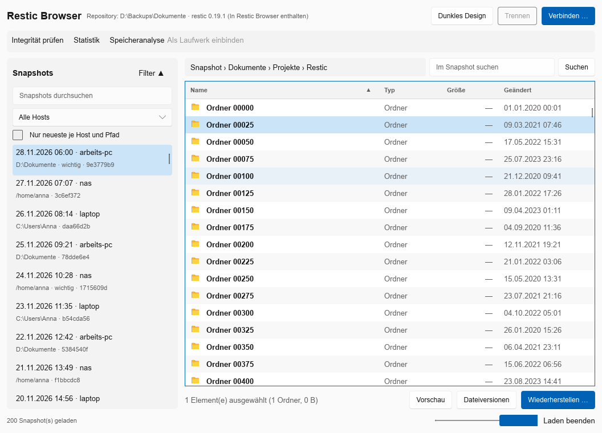
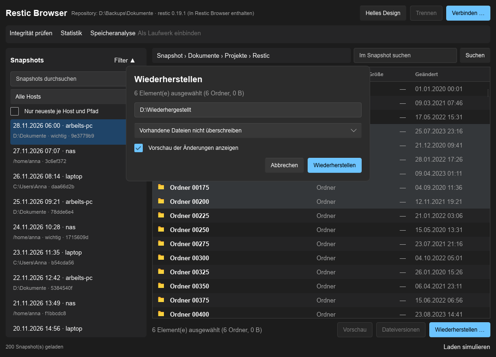
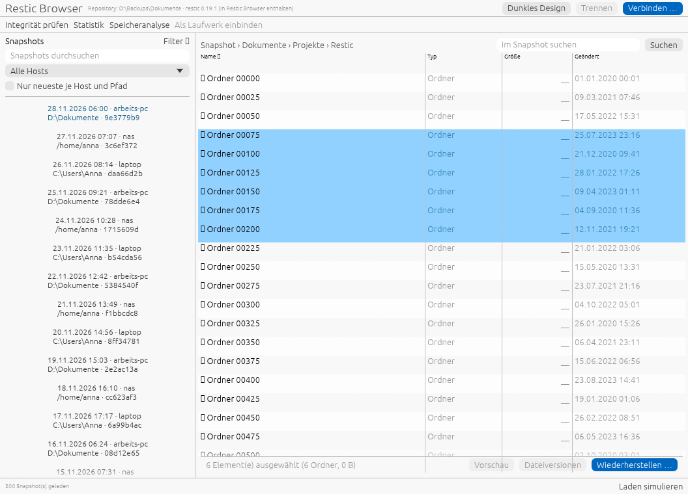
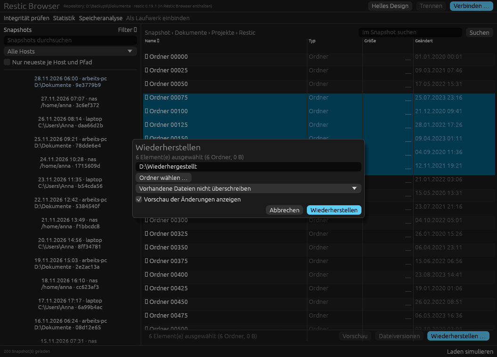

# UI-Spike: Slint für Restic Browser

> Hinweis (4.2.0): Die Entscheidung für egui ist getroffen und umgesetzt. Der Code beider Spikes
> (`rust/spikes/slint-ui`, `rust/spikes/egui-ui`) wurde aus dem Arbeitsbaum entfernt und liegt nur noch in der
> Git-Historie (zuletzt in Commit `a1c8de6`). Dieses Dokument bleibt als Begründung der Entscheidung erhalten;
> die Befehle unten lassen sich nur mit einem Checkout dieses Commits ausführen.

Stand: 6. November 2026. Der Spike (`rust/spikes/slint-ui`) prüft, ob Slint 1.18.1 die
Oberflächenregeln aus `AGENTS.md` erfüllt. Er ist ein verwerfbarer Versuch mit eigenem Workspace
und nicht Teil der Anwendung, der CI oder der Pakete.




## Ergebnis in Kürze

Slint erfüllt alle **messbaren** Kriterien. Zwei Standard-Widgets (Tabelle, Tooltip) reichen für
Restic Browser nicht aus und müssen selbst gebaut werden. Offen bleiben Linux, Datei-Dialoge und
echte Modalität. **Die Lizenzfrage ist nicht technisch und liegt beim Projekt** (siehe unten).

## Geprüft und bestanden

| Kriterium aus `AGENTS.md` | Ergebnis |
|---|---|
| Hell und Dunkel zur Laufzeit umschaltbar, unabhängig vom System | Ja, über `Palette.color-scheme`. Fehler im Spike: ohne Setzen beim Start folgte die App dem Windows-Schema. |
| Dunkle Titelleiste für Haupt- **und** Dialogfenster | Ja (`DWMWA_USE_IMMERSIVE_DARK_MODE` hell 0, dunkel 1, beide Fenster). Das Thema muss **nach** der Fenstererstellung gesetzt werden; ein Aufruf beim Start läuft ins Leere. |
| Zustände Normal, Hover, Fokus, Auswahl, Disabled | Ja, in beiden Themes (Screenshots, Hover und Klick per synthetischen Ereignissen). |
| Geöffnete Popups (ComboBox, Dialog) im Thema | Ja. |
| Spaltenanfasser unsichtbar, aber bedienbar | Ja mit eigener Tabelle (Ziehen 340 px auf 400 px getestet). |
| Mehrfachauswahl (Strg, Umschalt, Strg+A, Pfeiltasten) | Ja mit eigener Tabelle. |
| Ladebalken nur bei echtem Laden | Ja (Endlosanimation nur bei `loading`). |
| Dezente Animationen (150 ms, Ease-Out) | Ja. |
| 100.000 Zeilen | Release: Modellaufbau 0,3 s, Alles auswählen 48 ms, Sortieren 65 ms (nach Name 390 ms wegen des Vergleichs im Spike), Speicher 128 MB bei 100.000 Zeilen (94 MB bei 1.000). |
| Größe | Release-Datei 14,5 MB ohne restic. |

## Nicht ausreichend im Standard

- `StandardTableView` kennt nur eine aktuelle Zeile (`current-row`), keine Mehrfachauswahl, und
  zeigt den Spaltenanfasser beim Überfahren sichtbar. Der Dateibrowser braucht eine **eigene
  Tabelle** (im Spike vorhanden, rund 250 Zeilen).
- Es gibt kein öffentliches Tooltip-Widget (`ToolTipImpl` ist intern). Tooltips müssen **selbst
  gebaut** werden (Verzögerung, Platzierung, Thema).
- `PopupWindow` ist ein Overlay im Fenster, kein Dialog: keine Titelleiste, nicht verschiebbar,
  nicht modal. Für Dialoge nach Art von `RestoreWindow` sind **echte zweite Fenster** nötig; sie
  funktionieren (geprüft). Modalität muss über plattformspezifische winit-Erweiterungen
  nachgebaut werden (z. B. `WindowExtWindows::set_enable` am Elternfenster) und ist ungeprüft.

## Nicht geprüft (Risiken für Phase 5)

1. **Linux/CachyOS:** Rendering, dunkle Titelleiste unter KDE/GNOME/Wayland, Schriften, Emoji-Symbole
   (die Datei-Symbole nutzen Emoji; unter Windows Segoe UI Emoji, unter Linux eine Emoji-Schrift nötig).
2. **Datei- und Ordnerauswahl** (Restore-Ziel): Slint hat keinen Dialog; nötig wäre ein Zusatz wie `rfd`
   (unter Linux GTK oder xdg-desktop-portal).
3. **Echte Bedienung:** Maus, Tastatur, Scrollgefühl und Tab-Reihenfolge wurden nur mit synthetischen
   Ereignissen und Screenshots geprüft, nicht von Hand.
4. **Barrierefreiheit** der eigenen Tabelle (Rollen, Fokus für Screenreader).
5. Kontextmenü (`ContextMenuArea`), Zwischenablage, Eingabemethoden (IME).
6. Build-Zeit: rund 2 Minuten für Release ab Null, rund 1,5 Minuten Debug.

## Lizenz (Entscheidung des Projekts)

Slint steht unter `GPL-3.0-only OR LicenseRef-Slint-Royalty-free-2.0 OR LicenseRef-Slint-Software-3.0`
(Quellen: Lizenzangaben der Slint-Pakete und der Royalty-free-Text auf slint.dev). Dieses
Repository steht unter **MPL-2.0**. Die Optionen:

- **GPLv3:** Slint wäre für das ausgelieferte Programm GPLv3-lizenziert. Die MPL-2.0 erlaubt
  nach ihren Regeln zu „Secondary Licenses“ die Verwendung in einem GPL-Werk; das gelieferte
  Programm wäre dann insgesamt GPLv3. Eigene Dateien können MPL-2.0 bleiben.
- **Royalty-free-Lizenz 2.0:** kostenlos für Desktop-Anwendungen, aber nur mit sichtbarem Hinweis
  auf Slint (z. B. `AboutSlint`-Widget oder Slint-Abzeichen) und nur für Anwendungen auf dem
  Allzweck-Rechner der Nutzer. Ohne den Hinweis wäre die kommerzielle Lizenz nötig.
- **Kommerziell:** bezahlt, ohne diese Auflagen.

Das ist **keine Rechtsberatung**. Die Verträglichkeit mit der MPL-2.0 bei Weitergabe als
Programmdatei sollte bei Slint (info@slint.dev) oder juristisch bestätigt werden, bevor Slint
übernommen wird. Wird keine Option akzeptiert, bleibt egui (oder iced) als Alternative; diese wurden
nicht untersucht.

## Aufwand für Phase 5 mit Slint (grobe Einschätzung)

Eigene Bausteine: Dateitabelle (vorhanden als Spike), Snapshot-Liste, Pfadleiste, Tooltips,
Dialogfenster mit Modalität, Ordner-/Dateiauswahl, Barrierefreiheits-Rollen, `AboutSlint`/Hinweis,
8 Fenster (Haupt-, Verbindungs-, Restore-, Vorschau-, Versionen-, Prüf-, Speicheranalyse-, Mount-
Fenster). Die Logik dahinter liegt bereits in `restic-app` (`BrowserSession`).

## Empfehlung

Slint ist technisch tragfähig. Weiter mit Slint, **wenn** eine der Lizenzoptionen akzeptiert wird.
Vor dem Ausbau der Fenster zuerst klären: Lizenz, Linux-Verhalten (Titelleiste, Emoji, Datei-Dialog)
und echte Modalität. Der Spike lässt sich mit `--dark`, `--popup`, `--click x y`, `--hover x y`,
`--bench`, `--dialog` und `--screenshot datei.png` reproduzieren:

```text
cd rust/spikes/slint-ui
cargo run --release -- --dark --screenshot ui.png
```

---

# Zweiter Spike: egui/eframe 0.37 und Vergleich (Projektlizenz Apache 2.0)

Das Projekt soll unter **Apache 2.0** stehen (`docs/decisions.md`). Deshalb gibt es einen zweiten
Spike mit egui (`rust/spikes/egui-ui`, MIT OR Apache-2.0) und eine Lizenzprüfung der Abhängigkeiten
mit `cargo-deny` (`deny.toml`, Positivliste permissiver Lizenzen).




## Lizenzprüfung der Abhängigkeiten (`cargo deny check licenses`)

| Prüfobjekt | Ergebnis |
|---|---|
| Hauptworkspace (`restic-core`, `restic-app`, `restic-testkit`) | bestanden |
| egui-Spike | bestanden; einzige Ausnahme: eingebettete Standardschriften (`OFL-1.1`, `Ubuntu-font-1.0`), erlaubt das Mitliefern, verlangt Lizenzhinweise |
| Slint-Spike | **durchgefallen**: alle 12 Slint-Pakete nur unter `GPL-3.0-only OR Slint-Royalty-free-2.0 OR Slint-Software-3.0`, keine permissive Option |

Mit Apache 2.0 ist die GPLv3-Option von Slint ausgeschlossen. Die Royalty-free-Lizenz ist eine eigene
Weitergabebedingung (Hinweispflicht, Einschränkung auf Anwendungen auf Allzweck-Rechnern) und damit
kein Teil von Apache 2.0.

## Ergebnis egui gegenüber Slint

| Kriterium | Slint 1.18 | egui 0.37 |
|---|---|---|
| Lizenz zu Apache 2.0 passend | nein (GPL oder eigene Bedingungen) | ja (MIT OR Apache-2.0, plus Schriftlizenzen) |
| Hell/Dunkel zur Laufzeit | ja | ja |
| Dunkle Titelleiste Hauptfenster und Dialogfenster (DWM) | ja, beide | ja, beide (nach Fenstererstellung setzen, sonst im Hellmodus falsch) |
| Zustände Hover, Fokus, Auswahl, Disabled | ja | ja |
| Modaler Dialog | nur Overlay, nicht modal | `Modal` mit gesperrtem Hintergrund eingebaut |
| Echtes zweites Fenster | ja | ja (`show_viewport_immediate`) |
| Tooltips | selbst bauen | eingebaut (`on_hover_text`) |
| Tabelle mit Mehrfachauswahl | selbst bauen | `egui_extras::TableBuilder` mit virtualisierten Zeilen, Auswahl selbst |
| Spaltenanfasser unsichtbar | ja (eigene Tabelle) | **nein**: Trennlinien sind dauerhaft sichtbar |
| Datei-Symbole und Sortierpfeile | Emoji und Pfeile werden angezeigt | **fehlen** (leere Kästchen), Symbolschrift muss eingebettet werden |
| Barrierefreiheit | Slint-Accessibility, eigene Tabelle ohne Rollen | AccessKit eingebaut (nicht geprüft) |
| 100.000 Zeilen: Alles auswählen / Sortieren (Release) | 48 ms / 65 ms | 0 ms / 4 ms (nach Name 339 ms) |
| UI-Aufbau je Bild mit 100.000 Zeilen | nicht gemessen | 1,6 ms Mittel, 2,3 ms schlechtestes |
| Speicher bei 100.000 Zeilen | 128 MB | 96 MB |
| Release-Größe ohne restic | 14,5 MB | 6,7 MB |
| Release-Bauzeit | rund 2 Minuten | rund 52 Sekunden |
| Optischer Eindruck | ruhig, nah an Windows | funktional, sichtbar „egui“; ohne Feinschliff weniger poliert |

Rückmeldung des Projektinhabers: Die zuletzt gebaute Rust-Variante (egui) wirkte in Optik und Bedienung
besser als die vorherige. Der Eindruck kann ohne Symbole und Abstände täuschen; beides ist behebbar.

## Offene Punkte egui

1. Eigene Symbolschrift einbetten (z. B. Phosphor oder Noto Emoji; Lizenzen OFL/MIT, Eintrag in
   `THIRD-PARTY-NOTICES.md`) und Sortierpfeile zeichnen.
2. Spaltenanfasser unsichtbar machen: eigene Tabelle oder Anpassung von `egui_extras`.
3. Linux/CachyOS: Rendering, dunkle Titelleiste, `rfd` (xdg-portal) und Schrift ungeprüft.
4. Zeichnen nur bei Ereignissen: Ladezustände und Animationen müssen Neuzeichnen ausdrücklich anfordern
   (im Spike nur beim Laden).
5. Barrierefreiheit (AccessKit) und Eingabemethoden nicht geprüft; echte Bedienung nur mit
   synthetischen Ereignissen und Screenshots getestet.

## Empfehlung

**egui/eframe** für die Rust-Version: einzige der beiden Optionen, die zu Apache 2.0 ohne Auflagen
passt, mit eingebauten Tooltips, Modal und Dialogfenstern, kleiner und schneller. Die Schwächen
(Symbole, Anfasser, Politur) sind bekannte, begrenzte Arbeiten. Slint scheidet unter Apache 2.0 aus,
sofern die Royalty-free-Bedingungen nicht ausdrücklich als Ausnahme akzeptiert werden.
